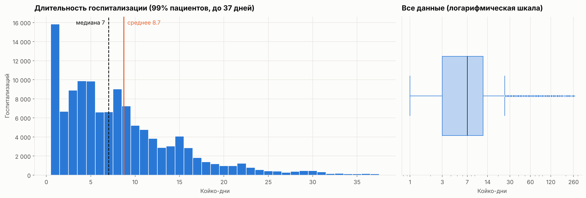
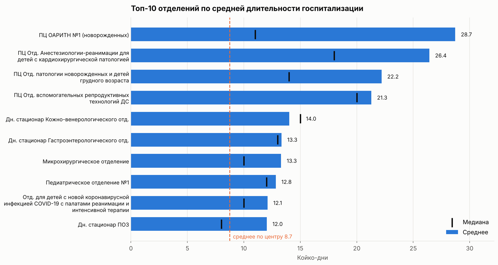
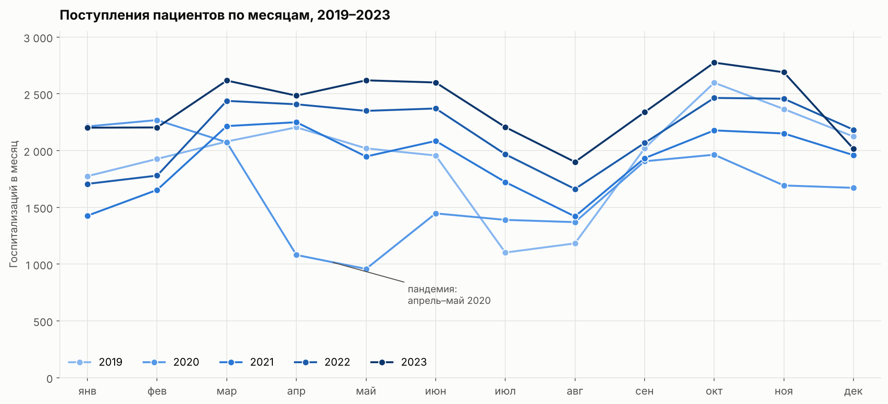
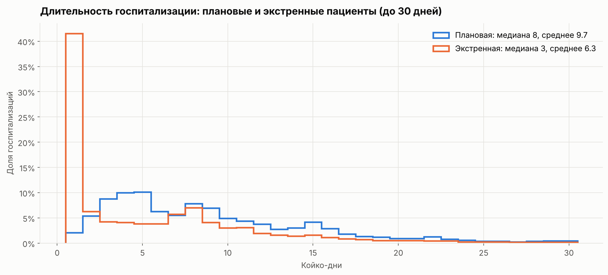

# Длительность госпитализации в федеральном медицинском центре


Анализ 120 тыс. госпитализаций федерального медицинского центра (ФГБОУ ВО СПбГПМУ) за 2019–2023 годы:
от чего зависит длительность лечения в стационаре, как меняется поток пациентов и подтверждаются ли
представления руководства о «нормальной» длительности госпитализации.

**[→ Открыть ноутбук с полным исследованием](notebooks/hospital_analysis.ipynb)**

## Главное

| | |
|---|---|
| **7 дней** | медианная длительность госпитализации — ровно стандарт; среднее (8,7) завышают редкие долгие случаи |
| **×2,5–3** | настолько дольше средней лежат пациенты перинатального центра и реанимации |
| **3,5 → 0,7 дня** | так сокращается разница между плановыми и экстренными пациентами, если убрать суточное наблюдение |
| **+23%** | рост числа госпитализаций в 2023 году по сравнению с доковидным 2019-м |



## Выводы

### Типичный пациент укладывается в стандарт

Половина пациентов лежит от 3 до 12 дней, медиана — 7. Распределение сильно скошено: среднее 8,7 дня
из-за небольшой доли госпитализаций на месяцы (максимум 266 дней). Пик в 1 день почти целиком даёт
отделение кратковременного наблюдения (ПЭМП ДПО), где 12 тыс. пребываний длятся сутки.

### Длительность определяется прежде всего отделением

Дольше всего лежат в отделениях перинатального центра: реанимации и выхаживания новорождённых,
вспомогательных репродуктивных технологий — 21–29 дней в среднем. Для рейтинга взяты отделения
с числом госпитализаций от 100, иначе среднее держится на единичных случаях.



### Поток пациентов растёт, сезонность устойчива

В апреле–мае 2020 года поступлений было вдвое меньше обычного: плановые госпитализации переносили из-за пандемии.
С 2021 года поток растёт на 11–15% в год. Каждый год повторяется провал в июле–августе и пик в октябре–ноябре.
Средняя длительность лечения при этом не меняется: нагрузка растёт за счёт числа пациентов.



### Проверка гипотез (α = 0.05)

| Гипотеза | Метод | Результат |
|---|---|---|
| Средняя длительность отличается от 7 дней | одновыборочный t-тест, двусторонний | ✅ **Да:** среднее 8,7 дня (95% ДИ 8,68–8,78), p < 0.001. Но медиана ровно 7 |
| Средняя длительность больше 10 дней | одновыборочный t-тест, односторонний | ❌ **Нет:** среднее ниже 10, p ≈ 1. Дольше 10 дней лежат 29% пациентов |
| Длительность у плановых и экстренных различается | t-тест Уэлча + Манна — Уитни | ✅ **Да, но эффект почти целиком — артефакт:** 9,7 vs 6,3 дня; без отделения суточного наблюдения разница всего 0,7 дня |

При 120 тыс. наблюдений значимой становится даже крошечная разница, поэтому для каждой гипотезы кроме p-value
посчитан размер эффекта в днях с доверительным интервалом.



### Рекомендации

- **Отчитываться медианой, а не средним**, и добавить долю пациентов дольше нормы: среднее искажают редкие долгие случаи.
- **Отделить суточное наблюдение от госпитализаций** в отчётности: оно занижает показатели экстренных пациентов.
- **Перераспределять плановые госпитализации на лето**, чтобы сгладить осенний пик нагрузки на койки и персонал.
- **Добавить в выгрузку дату направления.** Без неё нельзя ответить на исходный вопрос заказчика — сколько времени
  проходит от выдачи направления до поступления.

## Работа с данными

| Проблема | Решение |
|---|---|
| 4,4 тыс. полных дубликатов (3,5%), массово появились в выгрузке с 2021 года | удалены; повторные госпитализации одного пациента (21% пациентов) сохранены |
| Регион не указан у 55% записей, а «Санкт-Петербург» встречается всего 2 раза | вероятно, у местных пациентов поле не заполняют; отмечено как «Не указан», регион не используется в выводах |
| Даты хранятся строками, койко-дни — `float`, идентификаторы — числами | даты → `datetime`, койко-дни → `int`, идентификаторы → строки, категориальные признаки → `category` |
| Койко-дни во всех строках на 1 больше разницы дат | проверено: день поступления считается полным, данные согласованы |
| Длинные кириллические названия столбцов | переименованы в `snake_case` с проверкой незнакомых столбцов |

### Чем подход отличается от типового решения

| Типовое решение | Здесь |
|---|---|
| Столбец «регион» удаляется целиком | регион сохранён с меткой «Не указан», а сам пропуск исследован (Петербург в данных почти отсутствует) |
| Строки без кода МКБ удаляются | сохранены: для длительности госпитализации диагноз не нужен |
| В топ-10 отделений попадает отделение с 78 госпитализациями | порог от 100 госпитализаций, рядом со средним показана медиана |
| Динамика — одна линия уникальных пациентов по месяцам | госпитализации по месяцам с разбивкой по годам: видны пандемия, рост и сезонность |
| Обычный t-тест для групп разного размера и разброса | t-тест Уэлча + Манна — Уитни, доверительные интервалы и размер эффекта |
| Вывод: «плановые лежат на 3 дня дольше» | разница почти целиком создаётся отделением суточного наблюдения: без него 0,7 дня |

## Данные

`hospital.csv` — одна строка на госпитализацию: даты поступления и выписки, пациент, регион, плательщик,
источник финансирования, отделение и профиль, койко-дни, тип поступления (плановая / экстренная),
коды диагнозов по МКБ-10.

Исходный файл в репозиторий **не включён**: это записи о лечении пациентов, хоть и обезличенные,
и выкладывать их в открытый доступ не стоит. Ноутбук сохранён вместе с результатами, поэтому все расчёты
и графики видны без запуска. Чтобы воспроизвести анализ, положите `hospital.csv` из материалов курса в `data/raw/`.

## Структура

```
hospital-stay-analysis/
├── notebooks/
│   └── hospital_analysis.ipynb   # исследование с выводами
├── src/
│   └── hospital.py               # загрузка и предобработка
├── data/raw/                     # сюда положить hospital.csv
├── reports/figures/              # графики
└── requirements.txt
```

## Запуск

```bash
git clone https://github.com/EfimovAN18/hospital-stay-analysis.git
cd hospital-stay-analysis
python -m venv .venv && source .venv/bin/activate   # Windows: .venv\Scripts\activate
pip install -r requirements.txt
jupyter notebook notebooks/hospital_analysis.ipynb
```

## Стек

Python · pandas · NumPy · SciPy · Matplotlib · Jupyter

---

Автор: **Алексей Ефимов** — [github.com/EfimovAN18](https://github.com/EfimovAN18)
